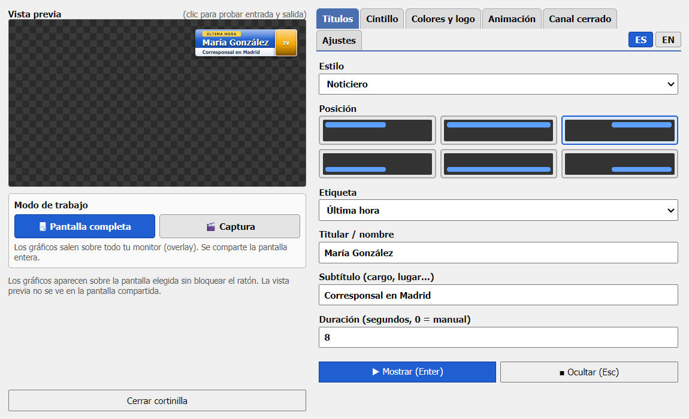
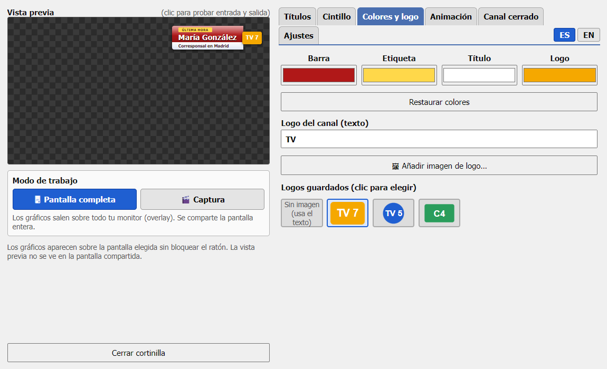
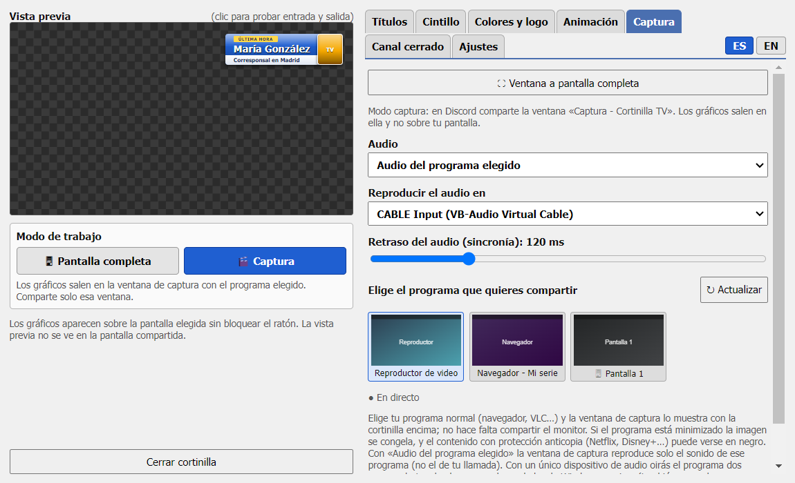
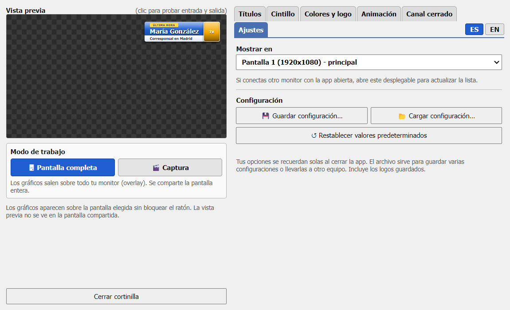
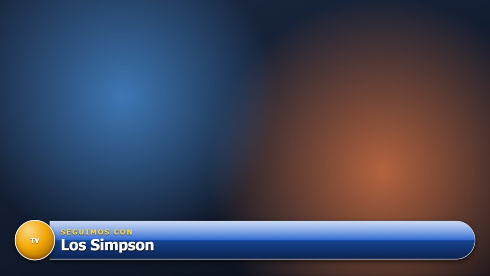
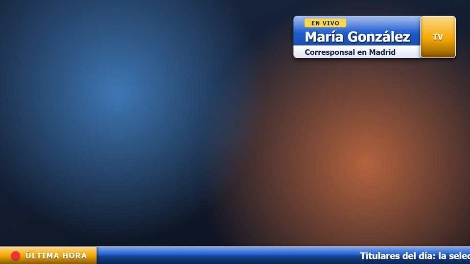
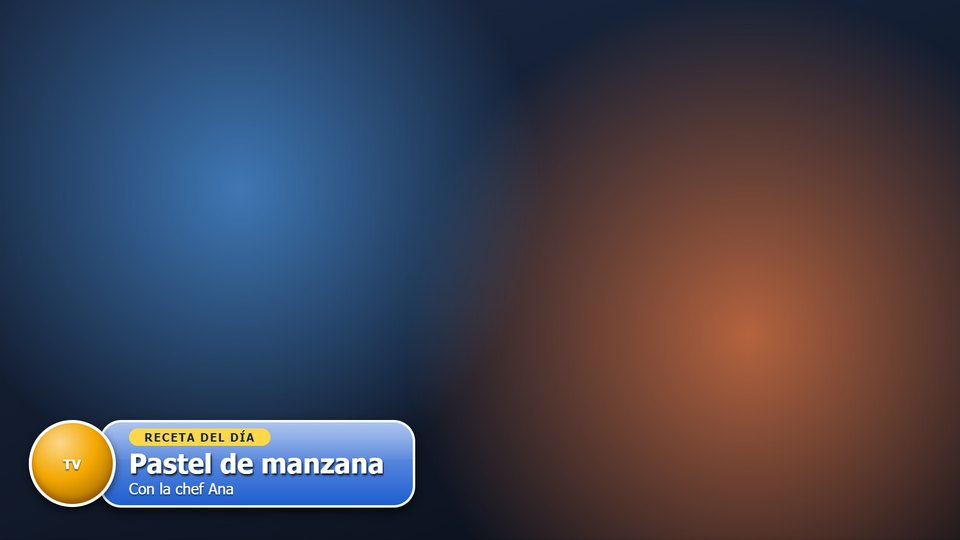
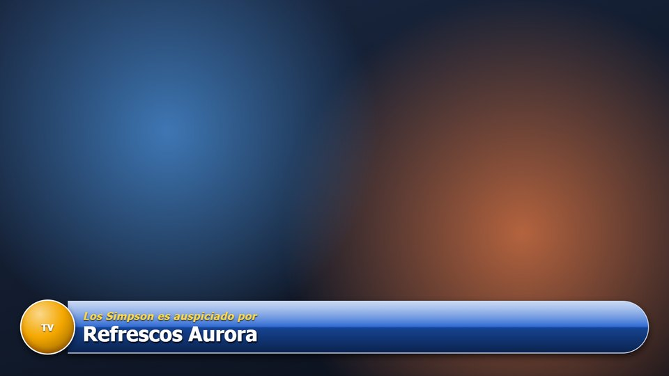
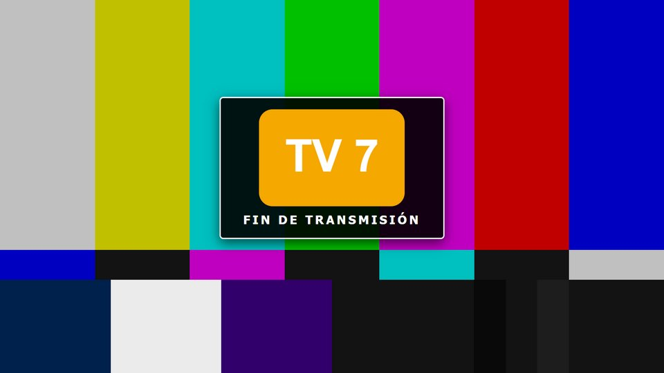
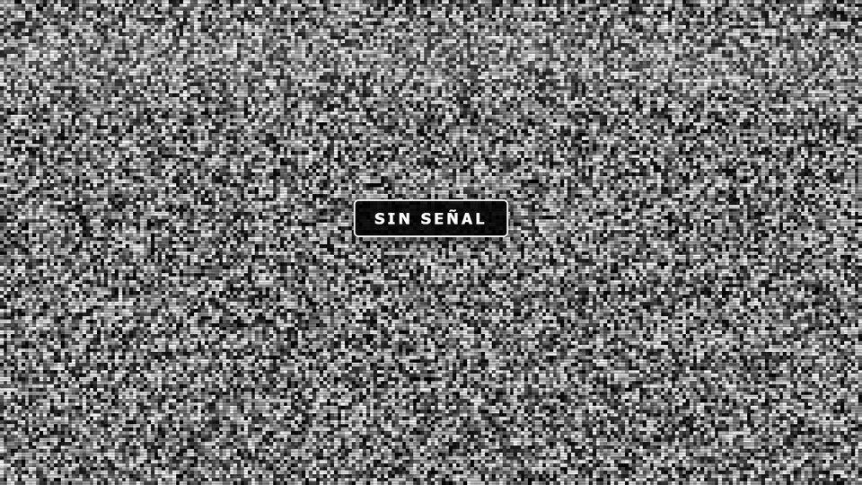

# Cortinilla TV 📺

**Español** · [English](#english)

Una cortinilla ("lower third") de televisión al estilo 2004 para tus maratones de series por pantalla compartida: barra azul brillante, logo redondo y frases como *"A continuación"* o *"Seguimos con"* seguidas del nombre de la serie.

Es una app de escritorio (Electron) con dos ventanas:

- **Overlay:** ventana transparente, sin bordes y siempre encima, que ocupa la pantalla que elijas. No bloquea el ratón.
- **Panel de control:** vista previa y botones siempre a la izquierda; a la derecha, pestañas (Títulos, Cintillo, Colores y logo, Animación, Ajustes).

## Características

- **Cuatro estilos** de gráfico: *Cortinilla de series*, *Noticiero*, *Matutino* y *Auspicio* (con frases como "Este programa es auspiciado por…" o "[Serie] es auspiciado por…").
- **Posición a elegir**: esquinas o barra de ancho completo, arriba o abajo.
- **Generador de caracteres**: etiqueta, título y subtítulo (por ejemplo nombre y cargo), con frases predefinidas o texto propio.
- **Cintillo desplazable** tipo noticiero, arriba o abajo; se apila con la cortinilla sin taparla. La etiqueta se elige entre frases predefinidas ("Última hora", "Urgente"…) o personalizada, y puede llevar un ícono (emoji o el logo del canal).
- **Barrido de entrada y salida configurable**: desde un lado, sube/baja, desvanecer, zoom, rebote o revelado, con velocidad ajustable.
- Frases predefinidas en **español e inglés**: cambia de idioma con los botones **ES / EN** (el panel también cambia).
- **Vista previa** en el propio panel (no aparece en la pantalla compartida) para elegir colores y probar la entrada y salida con un clic.
- Elección de la **pantalla** donde aparece (por defecto, la segunda si existe).
- **Logos guardados**: añade tantas imágenes como quieras (PNG, JPG, GIF, WebP o SVG) y cambia entre ellas con un clic; también puedes usar solo texto corto.
- **Dos modos de trabajo**: *Pantalla completa* (los gráficos salen sobre todo tu monitor, el overlay de siempre) y *Captura* (una ventana propia con el programa elegido y los gráficos encima). Se cambia con un clic.
- **Configuración**: guardar todas las opciones en un archivo, cargarlas después y restablecer los valores predeterminados.
- **Modo captura para Discord (sin OBS)**: captura tu programa normal (navegador, VLC…) en una ventana propia con los gráficos encima, y compartes solo esa ventana en vez de todo el monitor.
- **Pantallas de cierre** a pantalla completa: *barras de color* con el logo al centro, o *nieve* de TV antigua (estática animada), con texto opcional y sonido opcional (tono de 1 kHz o siseo).
- **Colores** configurables para la barra, la frase, el título y el logo.
- Duración automática o manual.
- Recuerda tus preferencias entre sesiones.

## Capturas de pantalla

Las imágenes usan datos y fondos de ejemplo.

### Panel de control

| | |
| --- | --- |
| <br>**Títulos: estilo, posición, frase y texto** | <br>**Colores y logos guardados** |
| <br>**Captura: programa, audio y retraso (modo captura)** | <br>**Ajustes: pantalla y configuración** |

### Gráficos

| | |
| --- | --- |
| <br>**Cortinilla de series** | <br>**Noticiero con cintillo desplazable** |
| <br>**Matutino** | <br>**Auspicio** |
| <br>**Canal cerrado: barras de color y logo** | <br>**Canal cerrado: nieve de TV antigua** |

## Requisitos

- [Node.js](https://nodejs.org/) 18 o superior.
- Windows (probado), macOS o Linux (sin probar).

## Uso

```bash
npm install
npm start
```

En Windows también puedes hacer doble clic en `iniciar.bat`.

1. Comparte **la pantalla completa** donde aparece la cortinilla (no una ventana suelta).
2. Escribe el nombre de la serie en el panel y pulsa **Enter** para mostrarla; **Esc** la oculta.
3. Deja el panel en otra pantalla o minimízalo, para que no salga en lo que compartes.

### Atajos

| Tecla | Acción |
| ----- | ------ |
| Enter | Mostrar la cortinilla (en la pestaña Cintillo, mostrar el cintillo) |
| Esc   | Ocultar la cortinilla |

### Modo captura: compartir solo una ventana en Discord

1. En el panel pulsa **🎬 Captura** (abajo a la izquierda) y, en la pestaña **Captura**, elige el programa que quieres mostrar (tu navegador, VLC…).
2. En Discord, *Compartir pantalla* → pestaña **Ventanas** → **«Captura - Cortinilla TV»**.
3. Mientras estés en modo captura, la cortinilla, el cintillo y las pantallas de cierre salen en esa ventana, no sobre tu monitor. Para volver al overlay sobre todo el monitor pulsa **🖥 Pantalla completa**.

La pestaña Captura (programa, audio, retraso) solo aparece en modo captura, y la pantalla del overlay (pestaña Ajustes) solo cuenta en modo pantalla completa.

**Audio:** en la pestaña Captura elige *Audio del programa elegido*. La app captura **solo el sonido de ese programa** (no el de tu llamada) con un pequeño ayudante propio ([`native/ProcessLoopback.cs`](native/ProcessLoopback.cs)), que usa la API de captura por proceso de Windows 10/11 y se compila solo la primera vez con el compilador que ya trae Windows. La escena lo reproduce y Discord lo toma de esa ventana. Con un único dispositivo de audio oirás el programa dos veces (el original y el de la escena), y bajar el volumen en el mezclador de Windows no lo arregla, porque también apaga lo que oye Discord. Para oírlo una sola vez, elige otro dispositivo de salida para el audio de la escena, por ejemplo un cable de audio virtual como VB-CABLE. Hay un ajuste de retraso para sincronizar con la imagen. El audio por programa solo funciona al elegir una **ventana**, no una pantalla.

Limitaciones del modo captura: si el programa elegido está minimizado la imagen se congela, y el contenido con protección anticopia (Netflix, Disney+…) puede verse en negro.

### Guardar, cargar y restablecer la configuración

En la pestaña **Ajustes**, bloque *Configuración*:

- **Guardar configuración…** escribe todas tus opciones (estilo, colores, animación, cintillo, pantallas de cierre, ajustes de captura, idioma, modo y los logos guardados) en un archivo `.json`.
- **Cargar configuración…** lee uno de esos archivos y lo aplica; solo se aceptan las opciones conocidas.
- **Restablecer valores predeterminados** vuelve a las opciones de fábrica (los logos guardados se conservan).

Las opciones también se recuerdan solas al cerrar la app; el archivo sirve para tener varias configuraciones o llevarlas a otro equipo.

### Limitaciones

- Si compartes una ventana en vez de la pantalla, la cortinilla no se verá.
- Algunos reproductores en pantalla completa exclusiva pueden taparla.
- Solo cubre una pantalla a la vez.

## Versión para OBS

[`obs/index.html`](obs/index.html) es una versión de una sola página (con fondo transparente) para usarla como *Fuente de navegador* en OBS, sin necesidad de Electron.

## Estructura

| Carpeta / archivo | Descripción |
| ----------------- | ----------- |
| `src/main/main.js` | Arranque de Electron y ciclo de vida de la app (una sola instancia). |
| `src/main/windows.js` | Las tres ventanas: overlay sobre la pantalla, panel de control y ventana de captura. |
| `src/main/ipc.js` | Mensajes entre el panel y las demás ventanas (gráficos, pantalla, logos, captura, configuración). |
| `src/main/app-audio.js` | Captura de audio por programa: compila y lanza el ayudante nativo. |
| `src/main/preload.js` | Puente seguro entre las páginas y el proceso principal. |
| `src/panel/` | Panel de control: `panel.html`, `panel.css`, `panel.js` y los textos ES/EN en `i18n.js`. |
| `src/overlay/overlay.html` | Los gráficos que se dibujan sobre la pantalla. |
| `src/capture/` | Ventana de captura (`capture.html`) y el reproductor del audio capturado (`pcm-player.js`). Internamente el código la llama *scene*. |
| `src/shared/` | Lo común al overlay, la ventana de captura y la vista previa: `lower.css`, `lower.js` (gráficos, cintillo y pantallas de cierre) y `bridge.js` (conexión con el panel). |
| `native/ProcessLoopback.cs` | Código del ayudante de audio por programa (el `.exe` se genera en cada equipo y no se sube). |
| `obs/index.html` | Versión independiente para OBS. |

## Privacidad

La app no usa red ni envía datos. Tus preferencias y el logo elegido se guardan solo en el almacenamiento local de la app en tu equipo, no en este repositorio.

## Soporte

Este es un proyecto personal, hecho por diversión y compartido tal cual (ver la licencia). No ofrezco soporte ni garantizo que se resuelvan los problemas o se acepten sugerencias. Si encuentras un error puedes abrir un *issue*, pero puede que no lo atienda.

## Licencia

[MIT](LICENSE) © 2026 Richard Peña. Los logos y marcas que cargues en la app pertenecen a sus respectivos dueños.

---

## English

A 2004-style TV lower-third for your screen-sharing series nights: glossy blue bar, round logo, and phrases like *"Up next"* or *"Coming up"* followed by the show's name.

It's a desktop app (Electron) with two windows:

- **Overlay:** a transparent, frameless, always-on-top window covering the screen you choose. It never blocks the mouse.
- **Control panel:** preview and buttons always on the left; tabs on the right (Titles, Ticker, Colors & logo, Animation, Settings).

### Features

- **Four graphic styles**: *Series bumper*, *News*, *Morning show* and *Sponsor* (phrases like "This program is sponsored by…" or "[Show] is sponsored by…").
- **Choose the position**: corners or full-width bar, top or bottom.
- **Character generator**: tag, title and subtitle (e.g. name and role), with preset phrases or your own text.
- **Scrolling news ticker**, top or bottom; it stacks with the bumper without covering it. The label can be a preset ("Breaking news", "Urgent"…) or custom, and can carry an icon (emoji or the channel logo).
- **Customizable enter/exit animation**: from a side, rise/drop, fade, zoom, bounce or wipe, with adjustable speed.
- Preset phrases in **Spanish and English**: switch with the **ES / EN** buttons (the panel UI changes too).
- Built-in **preview** in the panel (never shown on the shared screen) to fine-tune colors and test the enter/exit with one click.
- Choose which **screen** it appears on (defaults to the second one if present).
- **Saved logos**: add as many images as you like (PNG, JPG, GIF, WebP or SVG) and switch between them with one click; or just use short text.
- **Two work modes**: *Full screen* (graphics over your whole monitor, the classic overlay) and *Capture* (its own window with the chosen program and the graphics on top). Switch with one click.
- **Configuration**: save all options to a file, load them later and reset to default values.
- **Capture mode for Discord (no OBS)**: captures your regular program (browser, VLC…) into its own window with the graphics on top, so you share just that window instead of the whole monitor.
- **Full-screen sign-off screens**: *color bars* with the logo in the center, or old-TV *snow* (animated static), with an optional caption and optional sound (1 kHz tone or hiss).
- Customizable **colors** for the bar, phrase, title and logo.
- Automatic or manual duration.
- Remembers your settings between sessions.

### Screenshots

The images use sample data and backgrounds. The control panel is shown in Spanish; switch it to English with the **ES / EN** buttons.

| | |
| --- | --- |
| <br>**Titles: style, position, phrase and text** | <br>**Colors and saved logos** |
| <br>**Capture: program, audio and delay (capture mode)** | <br>**Settings: screen and configuration** |
| <br>**Series bumper** | <br>**News with scrolling ticker** |
| <br>**Morning show** | <br>**Sponsor** |
| <br>**Sign-off: color bars and logo** | <br>**Sign-off: old-TV snow** |

### Requirements

- [Node.js](https://nodejs.org/) 18 or newer.
- Windows (tested), macOS or Linux (untested).

### Usage

```bash
npm install
npm start
```

1. Share your **entire screen** (the one showing the overlay), not a single window.
2. Type the show name in the panel and press **Enter** to display it; **Esc** hides it.
3. Keep the panel on another screen or minimized so it doesn't appear in the shared view.

### Limitations

- Sharing a single window won't capture the overlay.
- Some players in exclusive fullscreen may cover it.
- Covers one screen at a time.

### OBS version

[`obs/index.html`](obs/index.html) is a standalone single-page version (transparent background) you can use as a *Browser Source* in OBS, no Electron needed.

### Privacy

The app makes no network requests and sends no data. Your settings and chosen logo are stored only in the app's local storage on your machine, never in this repository.

### Support

This is a personal project, made for fun and shared as is (see the license). I don't offer support and can't promise that problems will be fixed or suggestions accepted. If you find a bug you can open an issue, but I may not get to it.

### License

[MIT](LICENSE) © 2026 Richard Peña. Logos and trademarks you load into the app belong to their respective owners.
